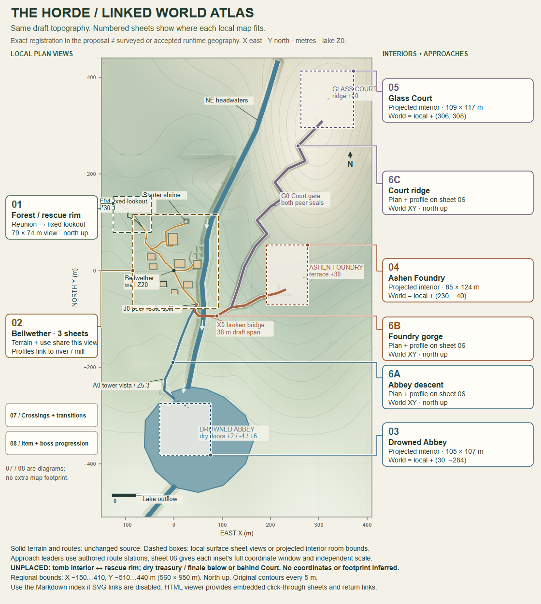

# The Horde / linked world-map atlas

For Sam: use the numbered overview to see **where the local maps fit**, then open their matching sheets below. The original terrain, water and routes are retained from the existing vector regional map; this is a navigation derivative, not a new world plan.

[Full vector overview](overview.svg) · [Self-contained HTML viewer](atlas.html) · [Coordinate and source evidence](coordinate-evidence.json) · [Validation](VALIDATION.md)

GitHub image previews may disable SVG links. Use the following Markdown links there. To use the interactive viewer, download `atlas.html` and open it in a browser (including Android); GitHub's HTML source page does not run the viewer. Its overview, local sheets and return links are embedded and work offline; original-source links require internet. Zoom/fit controls and horizontal scrolling keep detail readable on a phone. No site is deployed.

## Local sheet index

| Overview key | Local sheets | Spatial meaning |
|---|---|---|
| 01 | [Forest / rescue rim to lookout](sheets/01-forest.md) | Surface view; shared world XY |
| 02 | [Bellwether / terrain, use, river and mill](sheets/02-bellwether.md) | Surface view; shared world XY |
| 03 | [Drowned Abbey / floorplan and section](sheets/03-abbey.md) | Interior room-plate projection; explicit draft translation |
| 04 | [Ashen Foundry / floorplan and section](sheets/04-foundry.md) | Interior room-plate projection; explicit draft translation |
| 05 | [Glass Court / floorplan and section](sheets/05-court.md) | Interior room-plate projection; explicit draft translation |
| 06 / 6A–6C | [Approaches / three plan insets and profiles](sheets/06-approaches.md) | World XY plan insets + profiles |
| 07 | [Crossings / complications and transitions](sheets/07-transitions.md) | Diagram, no new footprint |
| 08 | [Dungeon theme, item and boss progression](sheets/08-progression.md) | Diagram, no new footprint |

## Alignment, scale and authority

All plans use **X east, Y north, Z up, metres**; north is up. Regional origin is Bellwether well XY(0,0), Z20; Z0 is the proposed Abbey lake, not sea level. Regional view bounds are X −150…410, Y −510…440 m: **560 × 950 m**, with 5 m contours and a 100 m scale bar. This is the plotted draft window, not a fixed total world size.

**Exact within the source model:** forest, arrival, town buildings and water coordinates equal the dungeon generator's retained baseline. Their local plan sheets use these world XY axes directly. The floorplan JSON gives local and translated world coordinates for every room. Dungeon translations have zero rotation: Abbey +(30,−284), Foundry +(230,−40), Court +(306,308). The dashed interior bounds match the source region boxes and union of room plates; they are not terrain, collision, roofs or a survey. Leaf pages record each view's own scale, bounds, elevation and a return link.

**Proposed blockout:** all metric geometry, route grades, water engineering and floor elevations remain proposals. Exact mathematical registration does not promote these to approved runtime geography. Surface-sheet rectangles show the plotted camera window, not a playable boundary. Approach leaders point to existing authored route stations; their full plan windows are recorded on sheet 06 and the coordinate evidence. Sections/profiles are not extra surface maps.

**Unknown / unplaced:** the original tomb interior is not surveyed into the rescue rim coordinates. No tomb footprint is added. Treasury/finale lie below or behind the Court ridge in the established topology, but no precise layout/extent is supplied; GC10 does not prove their coordinates. The historical village perspective and oblique whole-world concept are not metric local sheets. Future region directions remain directions.

The [shared roadmap](../../../ROADMAP.md) and [source inventory](../../../ROADMAP_SOURCES.md) retain scope/status authority. Active PR27 world development, source geometry and game assets are untouched.

## Source custody and rebuild

The source is pinned to planning commit `d37f16381311c6e620f0c4a9d01c1cce83260dc8`, retained on `docs/horde-1.6.2-roadmap`. The overview copies the original regional SVG's map subtree and definitions, adds extents/leaders outside critical routes and changes only its display transform. It never invokes the archived generators or overwrites the originals. Source hashes, exact windows and transforms are in [coordinate evidence](coordinate-evidence.json).

Run `python docs/design/world/atlas/build_atlas.py` from a checkout with that planning Git object. Python's standard library generates the SVG, Markdown sheets, evidence and offline HTML. The WebP overview is a browser render of the vector derivative, not an independently redrawn map. The source generators and all eleven original map images were inspected before placement.

[Original regional SVG](https://github.com/Samfa12-tech/The-Horde-RT-demo/blob/d37f16381311c6e620f0c4a9d01c1cce83260dc8/docs/design/world/dungeons/01-connected-region.svg) · [Original regional image](https://github.com/Samfa12-tech/The-Horde-RT-demo/blob/d37f16381311c6e620f0c4a9d01c1cce83260dc8/docs/design/world/dungeons/01-connected-region.webp) · [Connected source index](https://github.com/Samfa12-tech/The-Horde-RT-demo/blob/d37f16381311c6e620f0c4a9d01c1cce83260dc8/docs/design/world/connected/README.md) · [Dungeon source index](https://github.com/Samfa12-tech/The-Horde-RT-demo/blob/d37f16381311c6e620f0c4a9d01c1cce83260dc8/docs/design/world/dungeons/README.md)
