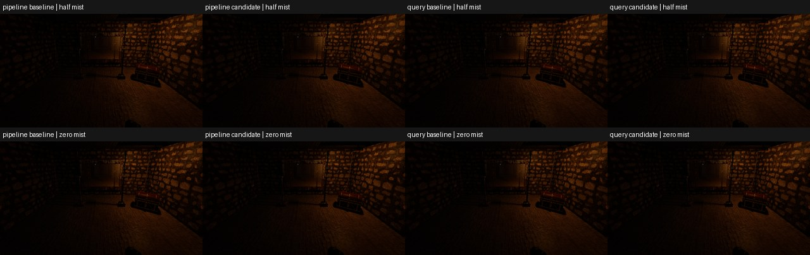

# Measured cleared-mist early exit

Keep this output-preserving optimisation. After the Keeper's room-mist density reaches exactly zero, the shader now returns neutral scattering/transmittance before source visibility and marching. The exact lower-tomb view is repeatedly about **18% cheaper in whole-RT-frame GPU time**, with better actual display pacing on both phone backends. This banks useful headroom for cleared-room backtracking. It does not solve the live two-torch cost or establish sustainable 30 FPS.

This is experiment 2 of the bounded performance pass; the preceding Opaque inverse-transform trial remains reverted. No third experiment is stacked onto this checkpoint. Completed chapter/tomb/material/niche/loading work is preserved. Canopy/Easy Tree and mist-shadow issue28 remain deferred.

## Change and correctness

The only production logic change is the initial `lichGroundMist` comparison, from `enemyKind < 0.5` to `enemyKind <= 0.75`. The existing density arithmetic already produces exactly zero at/below 0.75. Every positive fade, live Keeper and legacy/discharge discriminator retains its previous arithmetic. Surface shadows, lighting, geometry, density/extinction parameters, sample counts and resource ownership are unchanged.

All sixteen normal SPIR-V modules differ in exactly two words: the comparison opcode and its constant operand. Both existing compatibility modules have the same two-word change. All ten recorded structural metrics and every frozen limit are unchanged; budget SHA-256 is `56936479b2d202dbdb9393ba94b66a1b0bc12d490b700d8af4c63de3460e53bf`. The contract rejects the old gate, an epsilon cutoff and visibility queries placed before the gate. Canonical derived-consumer pins were refreshed only after the two-word differences were verified.

Body dissolve is not the mist fade: the previous 193/216/240-tick captures occur earlier. Two new development-only checkpoints advance actual accepted-hit/death simulation for 268/300 ticks, proving approximately half density and exact zero. CPU tests check the density/discriminator, retired corpse, completed animation, no pending attack and exclusion from the release registry. Android mappings and authored-scene admission counts include both states; existing missing/stale-terrain rejection remains intact.

**26 matched image pairs have zero changed pixels:** fourteen phone pairs and twelve Windows pairs across both real RT backends. These include positive-density death states, the new half/zero states, exterior landing and the phone's legacy Keeper view. Full frames and comparison sheets were opened and inspected. [Frozen-state and image identities](visual-parity.json) retain hashes; full PNGs stay local. The small gallery below shows the half/zero Windows comparisons, with Pipeline control/trial then Query control/trial in each row.

## Phone method and result

SM-S948B, Adreno 840, Android API37, Vulkan1.4.295, driver2150932499. Normal **Shipping/Mobile** shaders; no private shader bank, stage observer, dispatch-clock observer or image readbacks during timing. Development APK native code retains its existing O2; these are not signed Release measurements.

Saved settings are byte-identical: 40% dimensions, 576×1188 internal / 1440×2971 swapchain, CURRENT shadows, water1, fire0, glass off, mist on, dust1. All169 packaged asset payloads are byte-identical. The saved cap30 is preview policy and does not prove gameplay30 FPS.

The existing `chapter-performance-route` uses ordinary collision-resolved input: landing, descent, lower tomb, passage, return and second ascent. Each short run lasts about69 seconds. Exact lower/second-ascent poses match across runs; samples use the unchanged 60–300 held-view tick interval and stationarity check. Landing/passage stopping drift remains descriptive, excluded from exact-view gain claims. The predeclared useful-gain threshold is3%.

Six unique valid runs join **4,324 completed RT frames to their own actual Android presentations**, producing4,318 intervals. There is one fresh control and two trial runs per backend. All route-start current-HAL AP/BAT/SKIN comparisons pass framework0 and the original maximum1.5°C per-sensor difference. Full trajectories are retained; clock/power states are not experimentally fixed. This is not a completed ABBA design or a long steady-state thermal test.

| Exact lower-tomb view | Control GPU median | Two trial GPU medians | Improvement | Control → trial display median |
| --- | ---: | ---: | ---: | ---: |
| Pipeline | 71.082ms | 57.754 / 57.716ms | 18.75 / 18.80% | 83.333 → 66.667ms |
| QueryCompute | 67.611ms | 55.709 / 55.727ms | 17.60 / 17.58% | 75.000 → 66.667ms |

Lower-view GPU p95 falls72.077→58.305/58.434ms for Pipeline and68.525→56.523/56.599ms for Query. Whole-route display median is87.500→83.333/75.000ms for Pipeline and83.333→75.000/75.000ms for Query. Whole-route p95 remains about154.167/150.000ms respectively. No valid interval exceeds250ms; every interval still exceeds33.333ms. The maximum observed interval is166.598ms. GPU duration is the complete RT frame, not isolated mist/query time or reciprocal-GPU playable FPS.

The exact exterior second-ascent guard changes only+1.14–1.41% for Pipeline and−0.24–0.34% for Query, below the useful-gain threshold. It does not establish an outdoor improvement. Exterior GPU time remains roughly130–134ms and display spacing roughly142–154ms. [Per-run medians/tails, exact poses, temperatures, module identities and raw-file hashes](measurements.json) provide the complete comparison.

## Loading, artifacts and validation

Every valid route automatically unloads/restores one ordinary static detail owner, retains8,017,664B (7.65MiB) maximum saving, restores starting device-local/host-visible allocations exactly and reports zero readiness-wait frames. Pipeline starts/returns at160,793,152/48,085,184 accounted bytes; Query is512B lower in each classification. Device-local maxima remain262,915,584/262,915,072B; the owner overlap counter remains180,592,064B. Overlapping UMA classifications are not additive physical RAM. Coarse world, landmarks, shared/uncertain contributors and the working loading path stay intact; broader streaming/sustained acceptance remains open.

Source parent is `e218cfd3357f14a79efbc31b54e2ee9e15dbf813`. The timing control APK is `a49955a2638ae5bf0fc5e3ddc8bdf83c43a9335e5ada64f231503e66c95a8d6c`; timing trial is `d98cbc3acd8f78bc239f26875f573b59732ab2295e07fb4569b94bc5dc5849b2` (both183,557,978B). The trial's archived shader/test patch is `0a498f29d6f52c39f1a03533fc20e49c170c20cf19fd4dba10d67c34532ca278`.

The final phone candidate is `d0363ad6649aecdf3482fa2de7e6d635a8b4a23c2b101fb04929372723817dd0` (183,558,362B), adding only the two development capture states to that shader candidate. Its matched capture control is `bee98e4d2b4e20ae333cf1c81176e37f9476b437b6ebcaadf82be9af50edd5ec`. Combined owned source-patch SHA-256 is `b0f88ca0966be91434bcbfc77d0a312d105f8fcf5a31c776b0fa11b89b3d89bf`; test-only admission-count updates do not enter the APK. The final installed bytes and unchanged preferences are verified; Debug is stopped and the release app is untouched.

Native Debug/Release applications compile. Ten focused native CTest executions and all three shader gates pass, including actual character presentation, combat, both new mist states and both route/admission selections. Android four-ABI assembly, lint and all286 Java tests pass with zero skipped/failing tests. [Validation receipts](validation.json) retain exact log hashes. Exact pushed-commit six-job CI is reported on [PR27](https://github.com/Samfa12-tech/The-Horde-RT-demo/pull/27); base conflicts remain, with no merge/history rewrite. No limits or deadlines change: original torch180s, motion arm30s/run120s and display drain2s remain intact.

Raw APKs, patches, ledgers, full images, logs and local runners remain ignored under `reports/zero-mist-performance-2026-10-18-r01/`. Derived summaries exclude themselves from source inventories; every inventoried source hash was rechecked before sealing this receipt.

## Failed evidence and remaining gates

The initial prestart identity race, checkpoint207 failure and warm reverse-order control are excluded, never counted as measurements. In the checkpoint failure, actual RT initialization succeeded before CPU staging failed at tick0; subsequent control/trial startup probes and captures/runs succeeded, but its cause remains unattributed. The reverse-order control warmed BAT29.5→31.7°C during preparation, exceeding its reference30.0°C by1.7°C. That finite sequence stopped before route input. Exactly two final trial repeats used a colder preparation margin while keeping the actual1.5°C gate and all deadlines unchanged. [Failed-attempt receipt](failed-attempts.json) preserves identities and dispositions. Older hard-pin/freshness failures and the invalid Windows legacy-name request also remain local; none is a pass.

Bank this saving and keep performance work ahead of outdoor expansion. The live two-torch shader workload is the next priority for a separate bounded hypothesis. No third experiment starts here; larger reuse/filtering changes need their own correctness, image and cost review. Sustainable30 FPS, long warm sessions/live combat, startup/lifecycle/pressure, physical CURRENT/HIGHER and saved Lower→Current migration, and full chapter/owner visual/audio/haptic/touch acceptance remain open.

For the next owner check: fight the Keeper with both torches lit; inspect the death/mist fade and floor shadows; ascend, look around the clearing, descend and backtrack into the cleared room; then ascend again. Check equipment, collision and restored details. This short optimisation pass does not establish owner acceptance or complete the chapter.
