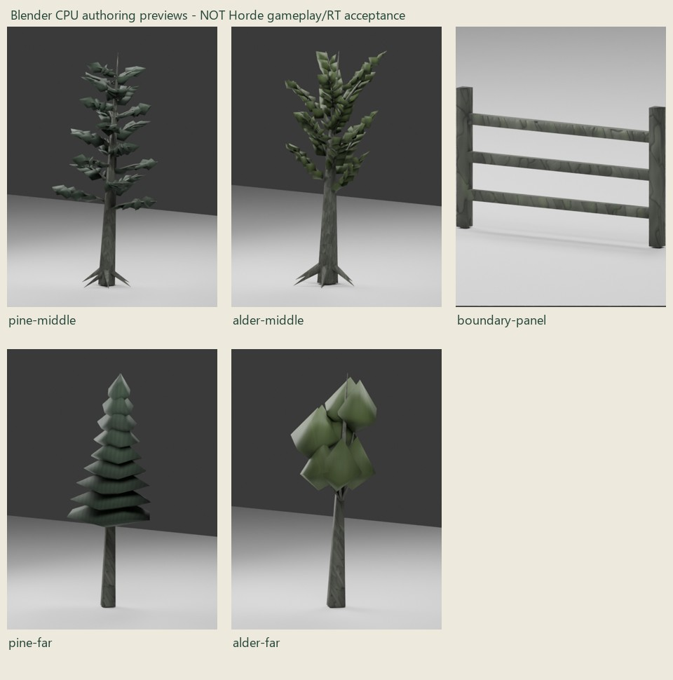

# Whole-route woodland source checkpoint

This is the first map-grounded whole-route authoring candidate after the exclusive
four-tree preparation proof, not completed/integrated forest. Production assets,
original64 placements, terrain, gameplay, collision and normal defaults are
unchanged. No phone, foreground, native game launch or policy retry occurred.

The source-only [package and reproducible recipes](../../../assets/models/world/source/forest-surroundings-v1/README.md)
preserve the approved world concept and coordinated R2 forest/region sheets.
Their exact native transform reproduces the six route stations and76.264 m trail.
The original concept is approved topology, not a measured placement prescription.

The composition has480 unique tree records:64 exact originals,96 middle trees
across eight stands and320 far trees across fifteen stands. Middle/far selection
uses the nearest possible walking-envelope distance, conservative mesh extent
and1.5 m fence-contour allowance; it is not camera-only detail reduction. Church/
tavern windows, river clearance and a conservative future town/garden reserve
stay clear. F01's protected pocket includes graves, shaft/slab and rope approaches;
the2.4 m clear trail and reunion/lookout pockets remain intact. All new roots are
fitted using actual imported r23 terrain and source bark-tip probes.

## Assets, budget and source review

| Source candidate | Triangles | Vertices | Role |
| --- | ---: | ---: | --- |
| Middle pine |1,474 |1,071 |Branch-supported closed sprays; minimum12 m geometry clearance |
| Middle alder |1,390 |1,017 |Branch-supported closed leaves; minimum12 m geometry clearance |
| Far pine |164 |102 |Simple opaque silhouette, minimum38 m geometry clearance |
| Far alder |180 |124 |Simple opaque silhouette, minimum38 m geometry clearance |
| Timber boundary panel |60 |40 |Original2.4 m three-rail module; actual boundary collision unadmitted |

All original model, centreline and image identities are retained. Every embedded
PNG matches its owned source byte-for-byte. No new texture/provider/paid asset or
third-party geometry; provenance is in `ASSET_LICENSES.md` and the package receipt.
The first middle draft remained sparse; it was replaced with distributed small
branch-supported sprays, keeping the original near assets untouched. Far shapes
are deliberately coarse. Studio review does not admit their in-game appearance,
repetition, silhouettes at practical render scales or forest enclosure.

Exact source cost:515,040 tree triangles versus323,264 control (+191,776).
Additional tree vertex/index payload10,949,376 B under the native64-byte vertex/
32-bit-index convention; authored upper bound26,848,640 B.196 fallback fence runs
add11,760 triangles/642,880 raw bytes. Final atlas reuse, AS, scratch, immutable CPU
copies, staging/transition peaks, driver allocation and frame cost are unmeasured.
This changes no renderer capacity, material/shader path, quality setting or runtime
LOD/instancing default. No performance saving is claimed.

## Boundaries are a correctness gate

The closed source layout preserves route/pockets and original trunk clearance,
with terrain-height endpoints and rail-conformance data.77 runs flag existing
bank inspection; remaining gaps have visible fence fallbacks. Prefer a mixed
grounded bank/rock/short-fence composition over a continuous forest fence. A bank
height observation is not proof that the player cannot traverse it. The fallback
layout and short module joins still require actual-world art/contact review.
Twelve existing native rock placements are retained as explicit source-map
references at nearby boundary joins; no rock or current collider is moved or
duplicated, and no boulder is presumed to seal an otherwise traversable gap.

No original collision is removed. New off-corridor trees deliberately need no
colliders only after the **visible** boundaries constrain actual walk/run/crouch/
dodge, Kit/rope access and return. No invisible sheet or traversable solid tree is
admitted. Source-only data cannot activate the prototype in either platform.

## Checks and limits

- Native static loader imports all five final GLBs under the bounded source
  manifest, with actual counts/bounds; no Vulkan device or app starts.
- Installed glTF Validator2.0.0-dev.3.10 reports zero errors/warnings on all five
  final files. [Compact exact-file receipt](validation.json). No dependency install.
- Ten Python source contracts cover exact regeneration,480 unique roots,
  unchanged originals/textures, topology/UV/normals/tangents/budgets, grouped stand
  populations, closed non-crossing boundaries, protected path/graves/shaft,
  conservative detail/grounding and rejection of changed originals, duplicate
  roots, fake admission or unproven boundary gaps.
- Five affected source CTests pass: new source contract, existing runtime roster,
  texture sources, placement contract and root fitting. Windows Release application
  and native static-loader target build. Final exact-head hosted CI is recorded
  separately after the development backup.
- Existing asset-admission/staging/archive regression passes201 cases. The new
  source namespace does not alter either platform's closed runtime roster.
- Portable-host CI fetch adds only the five new LFS source-test fixture GLBs.
  Android and Windows release runtime whitelists remain unchanged and exclude
  this source namespace; no package/default is enabled by the new CTest.
- The new texture-identity regression caught missing middle-image bytes caused by
  a draft local variable shadowing the original binary payload. Packing now retains
  the frozen source bytes and rejects empty buffer views. The failed GLBs/test log
  stay private under ignored `reports/forest-surroundings-v1-20261031/` alongside
  initial sparse previews and final validation. No failed candidate was admitted.
- Exact-head run41183933350 at18c8d57b passed five jobs but MSVC failed two
  source-identity assertions within the new Python contract (169/170 CTests passed).
  Its reported placement/rock hashes exactly equal CRLF checkouts of the same
  versioned text. The correction explicitly hashes these two editable inputs in
  canonical UTF-8/LF form; binary/frozen-archive and generated output checks stay
  exact. A new temp-only CRLF fixture regenerates every output byte and changed
  text/bare-CR negative probes remain. No original input or existing assertion,
  deadline, runtime quality or coverage was discarded. Corrected-head CI must be
  read separately; the original failure log is retained privately.
- Optional game-dev CLI is absent; no install/provider substitution. Blender5.2
  CPU studio previews and the source map are authoring evidence only. Large editable
  preview scenes/raw logs remain ignored; only representative images are retained.

Combined native scene intake/packing and a **new exact retention provenance proof**
remain pending. An old84,219-triangle or shared-instance certificate cannot be
reused for these new source shapes/placements. Keep the first native candidate
fully resident until contributor/restoration/recreation correctness passes.
No streaming or geometry-sharing claim follows from this source package.

Next review: whether this whole-route layout and middle/far asset direction warrant
one opt-in native integration. Then inspect moving F01/F02/bend/F03/F04 views,
up/side/return, real boundaries and landmark windows; measure actual resources and
frame work, followed by coordinated Android correctness/cost. Original4-tree
proofs remain controls, not completion. Sustained phone optimisation is ongoing,
not a fixed-FPS release veto. Audio/haptic revalidation for this source-only slice:
**NO**. Prior input/contact-audio/particle acceptance remains separately open.

## Subsequent bounded native checkpoint

The separately approved opt-in integration and native checks are now recorded in
[the native receipt](../2026-10-31-forest-surroundings-native/README.md).
This supersedes the source-only next-step status above, without turning the
source maps/studio images into gameplay evidence. Actual RT views fail the
surrounding-forest goal; normal play remains unchanged.
